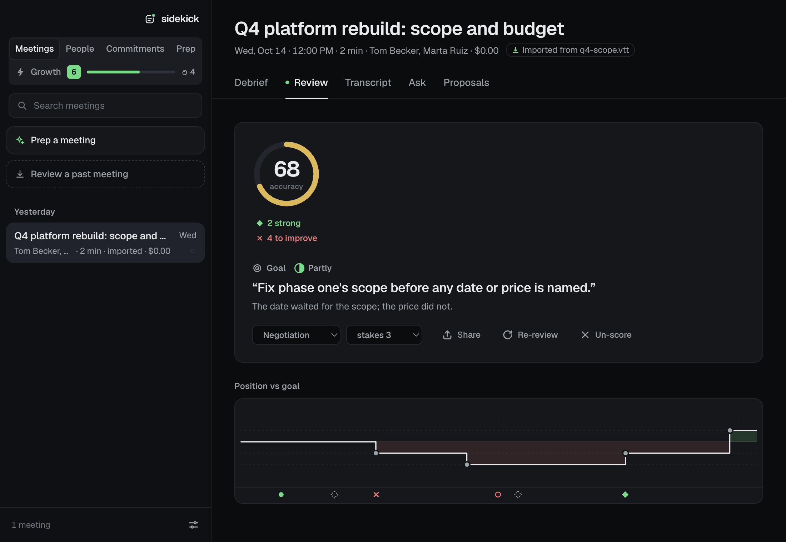
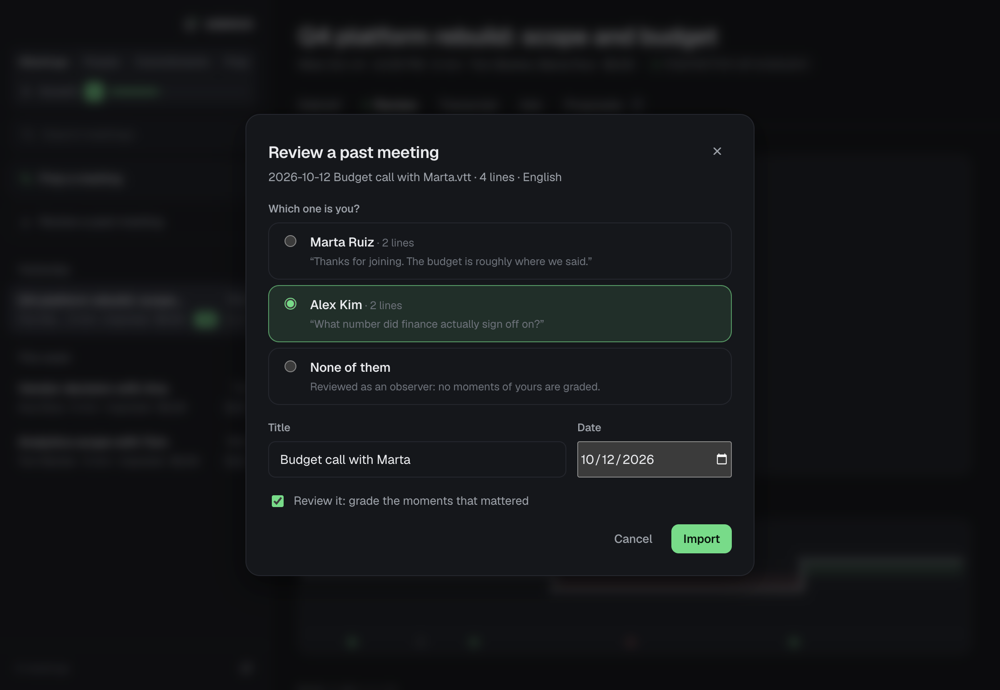
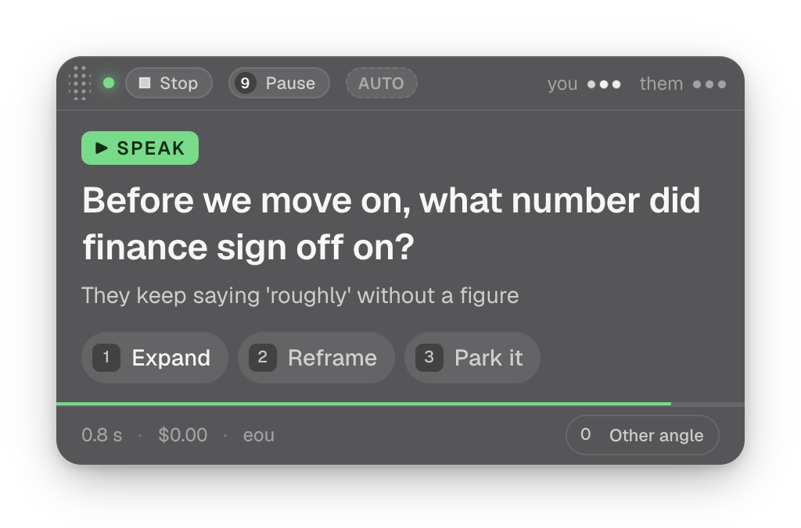

  

<h1 align="center">Sidekick</h1>

<b>Every meeting, reviewed move by move.</b> 
Sidekick grades the moments that mattered and shows you the stronger line. 
Runs on your Mac. Nothing is sent to us.

  <a href="https://learnwithsidekick.com/download">Download for Mac</a> ·
  <a href="https://github.com/gonzalocsv/sidekick-coach/releases">Releases</a> ·
  <a href="https://learnwithsidekick.com/community">Community routes</a> ·
  <a href="https://learnwithsidekick.com/docs/">Docs</a>

  <picture>
    <source media="(prefers-color-scheme: light)" srcset="docs/media/review-light.png" />
    
  </picture>

This repository is where Sidekick is released and supported: the downloads, the issue tracker, discussions and the
docs. The app's source code is not published here.

- **A coach, not a notetaker.** After a meeting, Sidekick grades the moments that mattered: Brilliant, Great, Good,
  Inaccuracy, Mistake, Missed, Blunder. Each grade stands on a line found in the transcript, said by the right person,
  with the stronger line when it could have gone better. A claim it cannot find is shown as not found and counts for
  nothing.
- **Local-first, with your own AI key.** Meetings, transcripts, notes and reviews are plain files and a database on
  your Mac. The coaching runs on your own Gemini or OpenAI key; transcribe on the Mac and your audio never leaves it.
  No account required, no telemetry.
- **Every grade stands on published research.** A behavior is graded only when a meta-analysis, replicated
  experiments or a peer-reviewed study backs it ([docs/EVIDENCE.md](docs/EVIDENCE.md)). Everything else may coach,
  never score.

## Install

[Download the app](https://learnwithsidekick.com/download), or take the `.dmg` from the latest
[release](https://github.com/gonzalocsv/sidekick-coach/releases/latest). macOS 14.2 or later on Apple Silicon. The app
updates itself from the releases here.

## Your first review in two minutes

Add your AI key, then you do not need to set anything else up to see what Sidekick does. Export the transcript of a
meeting you already had (Zoom, Google Meet and Teams all offer one; Otter, Fireflies and Granola exports work too),
open Sidekick and drop the file on the meetings list. Pick which speaker is you, and the debrief and the review
follow. No microphone, no permissions.

## Live in a call

When you want it in the room, Sidekick listens to your microphone and the meeting audio, and stays quiet until a
moment matters: an answer is due, a number is vague, a commitment is about to evaporate. Then one short card appears
over your call, and it is hidden from screen sharing. Google Meet works through a small browser extension; Teams and
Zoom are experimental.

## What we never do

- **No telemetry.** The app never reports anything about you or your meetings to us. There is nothing to opt out of.
- **No account required.** Everything works without signing up. An online account is optional and holds only your
  name, your email and whether you're a supporter.
- **No sharing of other people's words.** Routes and anything you export to the community contain only invented
  examples; a share card never contains what someone else said.
- **No grades without evidence.** If the research does not support grading a behavior, Sidekick does not grade it.

## Get help

- **Something broke:** [open an issue](https://github.com/gonzalocsv/sidekick-coach/issues/new/choose). Diagnostic
  logs from the app contain no transcript text.
- **Questions and ideas:** [Discussions](https://github.com/gonzalocsv/sidekick-coach/discussions).
- **A security issue:** please report it privately ([SECURITY.md](SECURITY.md)).
- **Routes:** the community library lives in [sidekick-routes](https://github.com/gonzalocsv/sidekick-routes).

## Free, and how to support it

Sidekick is free to use. If it earns its place in your week, [become a supporter](https://learnwithsidekick.com/supporter):
you get a supporter mark, a verified badge on the routes you write, and beta builds first.

## Docs

| | |
|---|---|
| [docs/EVIDENCE.md](docs/EVIDENCE.md) | the research behind every grade |
| [docs/LOCAL-STT.md](docs/LOCAL-STT.md) | transcription on your Mac |
| [docs/DATA-SAFETY.md](docs/DATA-SAFETY.md) | why an update can never lose your progress |
| [docs/SECURITY-LICENSING.md](docs/SECURITY-LICENSING.md) | what the supporter licence protects |
| [CHANGELOG.md](CHANGELOG.md) | every version |
| [Privacy](docs/legal/privacy.md) · [Terms](docs/legal/terms.md) · [Consent](docs/legal/consent.md) | the legal bits |

## Licence

Sidekick is free to use under its [terms](docs/legal/terms.md); the app and its source code are not open source
([LICENSE](LICENSE)). Community routes are CC BY 4.0.
